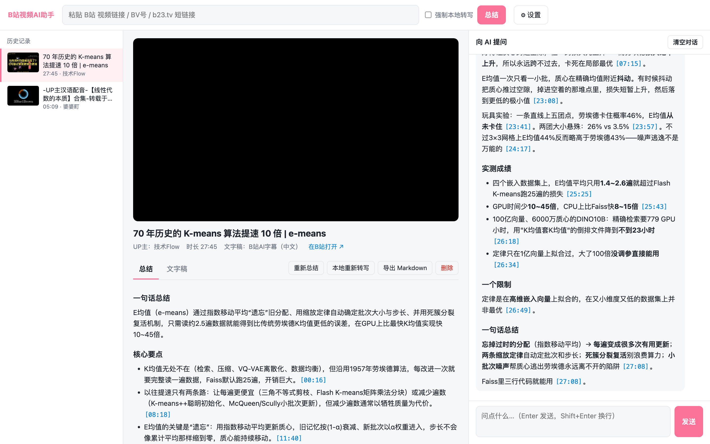

<div align="center">

# bili-ai

**Paste a Bilibili link, get a timestamped summary in seconds, then ask questions about the video.**

Runs locally · Your data stays on your machine · Falls back to on-device Whisper when there are no subtitles


[简体中文](README.md) | English

</div>



> The UI is in Chinese, since Bilibili is a Chinese video platform. Summaries and answers are generated in Simplified Chinese by default.

## Features

- **Structured summary**: one-line takeaway, key points, a topic-based outline and notable details, every item with a timestamp
- **Clickable timestamps**: jump the embedded player straight to the part you care about
- **Ask the video**: free-form Q&A grounded in the full transcript, with timestamps for every claim; anything from outside the video is clearly labelled
- **Works without subtitles**: downloads the audio and transcribes it locally with Whisper (`mlx-whisper` on Apple Silicon GPU, `faster-whisper` on Intel)
- **Long videos**: 3h+ videos are summarized chunk by chunk; Q&A retrieves the most relevant passages
- **Handy extras**: multi-part videos (`?p=2`), b23.tv short links, av IDs, history, Markdown export

## Quick start (macOS)

```bash
git clone https://github.com/smithshaojp/bili-ai.git ~/bili-ai
cd ~/bili-ai && bash start.command
```

The first run creates a virtualenv and installs dependencies, then opens http://127.0.0.1:8765.

Configure in **设置 (Settings)** at the top right, or via environment variables / a `.env` file (see `.env.example`):

| Setting | Required | Notes |
| --- | --- | --- |
| `DEEPSEEK_API_KEY` | Yes | Any OpenAI-compatible endpoint works if you change the base URL |
| `BILI_SESSDATA` | Recommended | Your Bilibili login cookie. Bilibili only serves subtitles to logged-in users; without it, most videos fall back to local transcription. Treat it like a password. |

Settings are stored in `config.json` (mode 600) next to the code. It is git-ignored, along with `.env` and `data/`.

## How it works

```
Bilibili link → resolve BV id / part → subtitles (uploader CC → Bilibili AI subtitles → local Whisper)
             → timestamped transcript → DeepSeek summary (map-reduce for very long videos)
             → Q&A with transcript + summary as context (retrieval for very long videos)
```

Stack: FastAPI, vanilla JS, the `openai` SDK (pointed at DeepSeek), `mlx-whisper` / `faster-whisper`, and PyAV for audio decoding (no ffmpeg needed).

## Contributing

Issues and PRs are welcome: Windows/Linux launch scripts, more LLM providers, YouTube support, better long-video retrieval.

## Disclaimer

This is an unofficial personal-study tool and is not affiliated with Bilibili. Please follow Bilibili's terms of service and do not use it for bulk scraping or redistributing other people's content.

## License

[MIT](LICENSE)
