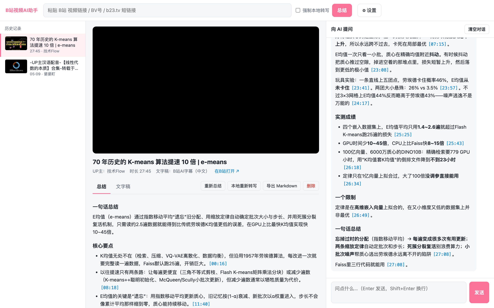

<div align="center">

# B站视频AI助手 · bili-ai

**贴一个 B站 链接，10 秒拿到带时间戳的总结，还能针对视频自由提问。**

本地运行 · 数据不上传 · 没字幕也能用本机 Whisper 转写


简体中文 | [English](README.en.md)

</div>



## 为什么做这个

一小时的教程、讲座、播客，真正有用的可能只有几分钟。bili-ai 先帮你把视频读一遍：

- **先看总结再决定看不看**：一句话总结、核心要点、按话题划分的大纲，每条都带时间戳
- **点时间戳直接跳转**：左侧播放器跳到对应位置，只看你关心的那一段
- **像问老师一样提问**：“第 20 分钟那个公式是什么意思？”“作者的结论有什么前提？”回答同样附带出处时间
- **没有字幕也能用**：自动下载音频，在你的 Mac 上用 Whisper 转写（Apple 芯片走 GPU，1 小时视频几分钟）
- **隐私友好**：服务只跑在 `127.0.0.1`，历史、文字稿、对话都存在本机，只有文字稿会发给你自己配置的 DeepSeek 接口

## 快速开始

```bash
git clone https://github.com/smithshaojp/bili-ai.git ~/bili-ai
cd ~/bili-ai && bash start.command
```

浏览器打开 http://127.0.0.1:8765 ，在右上角「设置」填入 DeepSeek API Key（或提前 `export DEEPSEEK_API_KEY=...`），贴链接即可。详细说明见下文。

## 启动（Mac）

1. 下载或克隆本仓库，比如：
   ```bash
   git clone https://github.com/smithshaojp/bili-ai.git ~/bili-ai
   ```
2. 打开「终端」，运行：
   ```bash
   cd ~/bili-ai && bash start.command
   ```
   第一次会自动创建虚拟环境并安装依赖（几分钟）。完成后浏览器会自动打开 http://127.0.0.1:8765
   以后也可以直接双击 `start.command`（如果提示“无法验证开发者”：右键 → 打开）。
3. 关闭终端窗口即退出。

> 国内网络 pip 安装慢/失败时：`PIP_MIRROR=https://pypi.tuna.tsinghua.edu.cn/simple bash start.command`
>
> 没有 Python：先运行 `xcode-select --install`，或 `brew install python`

## 配置

- **DeepSeek Key**：如果你的 shell 里已经有 `export DEEPSEEK_API_KEY=...`（写在 `~/.zshrc` 等），会自动读取，什么都不用填。
  也可以把 `.env.example` 复制成 `.env` 再填写，或在网页右上角「设置」里填。
- **B站 SESSDATA**（强烈建议填）：B站 的 AI 字幕需要登录才能拿到。没有它，很多视频只能走本地转写，会慢很多。
  获取方法：浏览器登录 bilibili.com → `⌥⌘I` 开发者工具 → Application → Cookies → 复制 `SESSDATA` 的值 → 粘到设置里。
  它等同于你的登录状态，**不要发给任何人**；在 B站 退出登录后会失效，需要重新复制。

设置保存在本目录的 `config.json`（权限 600，仅你自己可读）。

## 字幕来源优先级

1. UP主上传的 CC 字幕
2. B站 AI 自动生成字幕（需要 SESSDATA）
3. 都没有 → 下载音频，本机 Whisper 转写：
   - Apple 芯片（M1/M2/M3/M4）：mlx-whisper + large-v3-turbo，走 GPU，1 小时视频约几分钟
   - Intel Mac：faster-whisper small（CPU），1 小时视频大约 10~30 分钟
   - 首次转写会下载模型（约 1.5 GB）；能直连 huggingface.co 就直连，连不上才自动改用 hf-mirror.com 镜像

字幕质量差时可以点「本地重新转写」强制用 Whisper 重做。

## 功能

- 总结：一句话总结 / 核心要点 / 按话题的分段大纲 / 值得注意，时间戳可点击，左侧播放器跳到对应位置
- 问答：基于完整文字稿回答并附时间戳；视频外的知识会标注“视频外补充”
- 超长视频（约 3 小时以上）：自动分段提炼后再总结，问答时检索相关片段
- 支持分P（链接里的 `?p=2`）、b23.tv 短链接、av 号
- 历史记录、导出 Markdown（总结 + 问答 + 文字稿）
- 模型可切换 `deepseek-reasoner`（更深入、更慢、更贵）

## 常见问题

- **“被 B站 风控拦截（412）”**：请求太频繁，等几分钟；填上 SESSDATA 会好很多。
- **总结里的内容和视频对不上**：B站 偶尔会返回别的视频的 AI 字幕（B站 自己的 bug），点「本地重新转写」。
- **嵌入的播放器画质低/要登录**：点「在B站打开」看原视频，时间戳仍可参考。
- 数据在 `data/videos/*.json`，删掉即清空历史。

## 隐私与安全

- 本仓库不包含任何 API Key、Cookie 或个人数据。你的 Key 和 SESSDATA 只保存在本机的 `config.json` / `.env`，这两个文件都在 `.gitignore` 里。
- 如果你 fork 后自己改代码，提交前请确认没有把 `config.json`、`.env`、`data/` 加进去。

## 工作原理

```
B站链接 → 解析 BV号/分P → 取字幕（CC 字幕 → B站AI字幕 → 本机 Whisper 转写）
       → 合并成带时间戳的文字稿 → DeepSeek 生成总结（超长视频先分段提炼）
       → 问答时把文字稿 + 总结作为上下文（超长视频按相关度检索片段）
```

技术栈：FastAPI + 原生 JS 前端，`openai` SDK 调 DeepSeek，`mlx-whisper` / `faster-whisper` 做语音识别，PyAV 解码音频（不需要装 ffmpeg）。

## 参与贡献

欢迎提 Issue 和 PR，比如：支持 Windows / Linux 启动脚本、接入更多模型（OpenAI 兼容接口改 `base_url` 即可）、YouTube 支持、更好的长视频检索。

如果这个项目帮你省了时间，点个 ⭐ 就是最大的鼓励。

## 声明

本项目为非官方的个人学习工具，与哔哩哔哩无关。请遵守 B站 用户协议，仅用于个人学习，不要批量抓取或传播他人内容。

## 许可证

[MIT](LICENSE)
